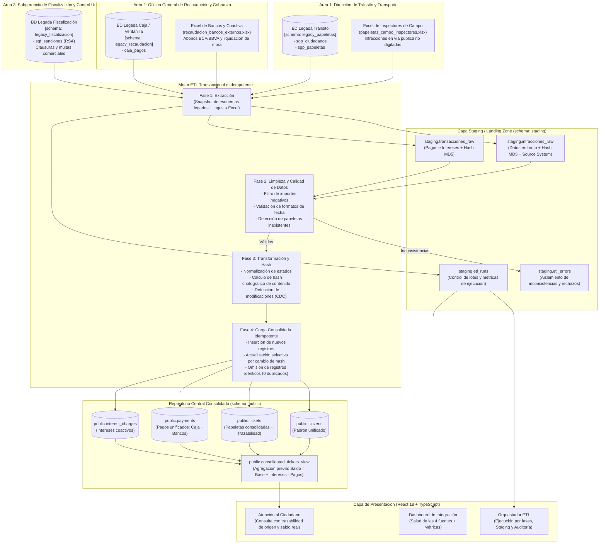

# Arquitectura de Integración de Datos Multi-Fuente — SIIAC (SI806U)

> 📥 **Descarga de Diagramas:**  
> - [Descargar Imagen PNG del Diagrama](file:///c:/Automatizacion%20Proy%20SW/public/diagrama_arquitectura.png)  
> - [Descargar Vectorial SVG del Diagrama](file:///c:/Automatizacion%20Proy%20SW/public/diagrama_arquitectura.svg)  
> - [Visor y Exportador en 4K Ultra-HD](file:///c:/Automatizacion%20Proy%20SW/public/export_diagram.html)  

El **Sistema Integrado de Información y Atención al Ciudadano (SIIAC)** es una solución arquitectónica diseñada para resolver la fragmentación de información en instituciones públicas descentralizadas mediante un proceso **ETL (Extract, Transform, Load)** y una **capa Staging**.

---

## 1. Diagrama de la Arquitectura de Integración

---

## 2. Decisiones Técnicas y Justificación

### A. Simulación Lógica de BDs Independientes (Esquemas PostgreSQL)
- **Decisión:** Los esquemas `legacy_papeletas` y `legacy_recaudacion` modelan bases de datos relacionales independientes.
- **Justificación:** Proporciona un aislamiento lógico riguroso en PostgreSQL sin requerir la sobrecarga de múltiples servidores Docker ni comprometer la portabilidad académica en Supabase.
- **Transparencia:** Representa una simulación lógica. En un entorno productivo real, estas fuentes residirían en servidores externos heterogéneos (MySQL, SQL Server, Oracle) consumidos vía Foreign Data Wrappers (`postgres_fdw`) o conectores Debezium/Kafka.

### B. Capa Staging y Quality Gate
- Los datos crudos no tocan el repositorio central directamente. Aterrizan en `staging.infracciones_raw` y `staging.transacciones_raw`.
- Las anomalías (montos negativos, papeletas vacías, fechas corruptas) se aíslan en `staging.etl_errors` permitiendo que los registros válidos continúen sin abortar la transacción.

### C. Estrategia de Idempotencia y Detección de Modificaciones (Change Data Capture)
- Cada registro procesado calcula un **hash MD5** de su contenido (`record_hash`).
- Al consolidar contra las tablas del Core:
  1. Si la clave de negocio no existe $\rightarrow$ **INSERT**.
  2. Si la clave de negocio existe pero el `record_hash` es diferente $\rightarrow$ **UPDATE** (actualización controlada de montos o reclasificaciones).
  3. Si la clave de negocio existe y el `record_hash` es idéntico $\rightarrow$ **NO-OP (Unchanged)** (prevención total de duplicados).

### D. Eliminación del Producto Cartesiano en la Liquidación de Saldo
Para una papeleta con $M$ pagos y $N$ cargos por intereses, la vista `consolidated_tickets_view` agrupa cada tabla separadamente en CTEs **antes** del JOIN:

$$\text{Saldo} = \text{Monto Base} + \sum(\text{Intereses}) - \sum(\text{Pagos})$$
