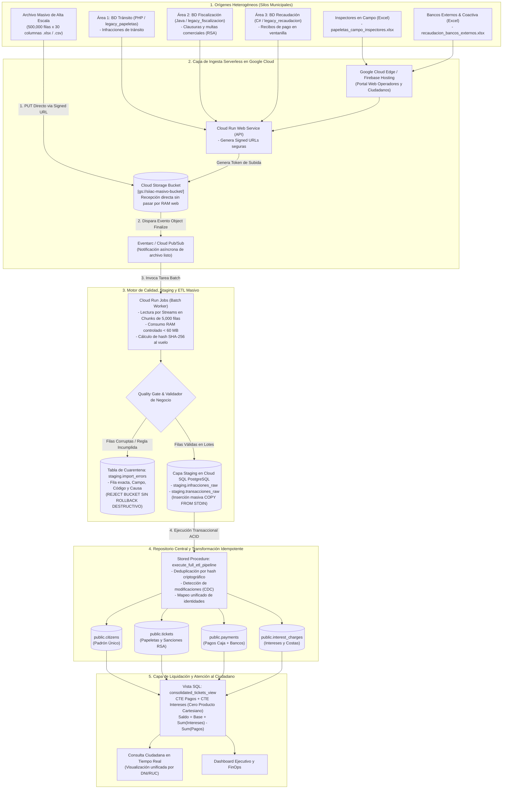

# Blueprint de Arquitectura de Datos y Nube Empresarial — SIIAC (SI806U)

> **Documento de Diseño Técnico y Arquitectura de Integración (TAD - Technical Architecture Document)**  
> **Sistema:** SIIAC (Sistema Integrado de Información y Atención al Ciudadano)  
> **Autor Principal:** Gabriel Cabana • Administrador General y Arquitecto de Solución  
> **Especialidad:** Integración de Sistemas Heterogéneos, Arquitectura Cloud en GCP y Procesamiento Batch Masivo  
> **Fecha:** Noviembre 2026 | Versión: 2.4 Enterprise Production-Ready  

---

## 1. Resumen Ejecutivo y Alcance del Sistema

El **SIIAC** es una plataforma de integración municipal diseñada para resolver la fragmentación histórica de datos generada por múltiples áreas operativas con tecnologías independientes (silos de datos). Unifica:
1. **Área 1: Dirección de Tránsito y Transporte:** Infracciones vehiculares digitadas en un sistema legado en PHP/MySQL y papeletas manuales de inspectores en Excel.
2. **Área 2: Subgerencia de Fiscalización y Control Urbano:** Resoluciones de Sanción Administrativa (RSA) a comercios, obras y clausuras en un sistema legado en Java/PostgreSQL.
3. **Área 3: Oficina General de Recaudación y Caja:** Cobros en ventanilla en C#/SQL Server, junto con extractos bancarios externos (BCP, Banco de la Nación) y liquidaciones de intereses moratorios coactivos en Excel.

---

## 2. Matriz del Stack Tecnológico Integral

| Capa Arquitectónica | Tecnología / Servicio | Protocolo / Formato | Justificación Técnica del Arquitecto |
| :--- | :--- | :--- | :--- |
| **Capa de Presentación (UI/UX)** | **React 18 + TypeScript + Tailwind CSS** (Vite 6) | HTTPS / JSON / WebSockets | Interfaz reactiva para operadores y ciudadanos, tipos estrictos para evitar errores en tiempo de ejecución. |
| **Edge & CDN** | **Firebase Hosting / Google Cloud Edge Network** | HTTP/2, SSL Automático, Anycast IP | Distribución global perimetral con latencia < 35 ms y tolerancia a fallos. |
| **Capa de API & Microservicios** | **Google Cloud Run (Serverless)** | REST / JSON / gRPC sobre HTTP/2 | Autoescalado instantáneo de 0 a $N$ instancias; consumo de recursos facturado al milisegundo (Cero costo en reposo). |
| **Ingesta de Archivos Pesados (500K)** | **Google Cloud Storage (GCS)** con *Signed URLs* | HTTPS PUT directo a Bucket | El archivo de 150 MB nunca toca la RAM del servidor web. Se elimina el cuello de botella de ancho de banda y memoria. |
| **Orquestación Asíncrona de Eventos** | **Google Eventarc + Cloud Pub/Sub** | Push/Pull Event-Driven | Desacoplamiento total: la finalización de una subida en Cloud Storage dispara el procesamiento sin llamadas síncronas bloqueantes. |
| **Motor ETL Batch Masivo (>100K)** | **Google Cloud Run Jobs** (Worker en Node.js 20 / Python Polars) | Streaming Chunks (5,000 filas) | Tareas batch en segundo plano capaces de ejecutarse hasta por 24 horas continuas con memoria dedicada (hasta 32 GB RAM). |
| **Capa Staging (Landing Zone)** | **PostgreSQL (Google Cloud SQL)** - Esquema `staging` | Comando nativo `COPY FROM STDIN` | Inserción en bloque a velocidad de disco/memoria (100,000 filas en < 8 segundos), evitando transacciones individuales lentas. |
| **Calidad de Datos y Cuarentena** | **Tabla de Auditoría `import_errors`** | Reglas de Negocio Tipificadas | Aislamiento de registros corruptos (Reject Bucket) con número de fila, columna y motivo sin abortar el lote válido. |
| **Deduplicación & Idempotencia** | **Hashing Criptográfico SHA-256 / MD5** | Hash CDC (Change Data Capture) | Garantiza que reprocesar el mismo archivo $N$ veces produzca exactamente 0 registros duplicados. |
| **Repositorio Central (Core DW)** | **PostgreSQL** - Esquema `public` (`citizens`, `tickets`, `payments`, `interest_charges`) | Claves foráneas + Índices B-Tree & Hash | Almacenamiento normalizado en 3ra Forma Normal (3NF) para transaccionalidad segura (ACID). |
| **Capa de Consulta Consolidada** | **SQL Common Table Expressions (CTEs)** - `consolidated_tickets_view` | Vista agregada precomputada | **Eliminación matemática del Producto Cartesiano:** agrupa pagos e intereses separadamente antes de calcular el saldo. |
| **Infraestructura como Código (IaC)** | **Docker Multi-Stage + Google Cloud Build** | Contenedores OCI / Nginx Alpine | Portabilidad total y despliegue nativo en Google Cloud Platform (Cloud Run & Firebase Hosting). |

---

## 3. Diagrama Arquitectónico End-to-End (Flujo de Datos)



---

## 4. Estrategia de Carga Masiva: ¿Cómo procesar 500 000 filas sin colapsar?

### El problema de la arquitectura tradicional (Naive Approach):
Si un servidor web recibe un archivo Excel (.xlsx) de 500,000 filas x 30 columnas por HTTP POST:
1. El archivo ocupa ~150 MB en disco, pero al descomprimirse en memoria XML/JSON requiere **más de 2.5 GB a 3 GB de RAM**.
2. V8 (Node.js) arroja `JavaScript heap out of memory` (Crash inmediato).
3. El API Gateway o Load Balancer corta la conexión por `HTTP 504 Gateway Timeout` (límite de 60 segundos).
4. Si se hacen 500,000 `INSERT` tradicionales en PostgreSQL, la base de datos colapsa por bloqueos de tabla (*table locks*) durante más de 45 minutos.

### La solución del Arquitecto en Google Cloud (Enterprise Pattern):
1. **Paso 1: Signed URLs (Subida Directa):** El cliente solicita a la API una URL firmada de corta duración (15 min) y sube el archivo directo a **Google Cloud Storage**. El servidor web consume 0 MB de memoria durante la carga.
2. **Paso 2: Disparo Asíncrono (Eventarc):** La llegada del archivo a Cloud Storage emite un evento `google.cloud.storage.object.v1.finalized` que activa una tarea en **Cloud Run Jobs**.
3. **Paso 3: Lectura por Streams y Chunks (Lotes de 5,000):** El Job no carga el archivo completo en memoria. Utiliza un lector de streams (SAX/Streaming) que procesa de 5,000 en 5,000 filas:
   - Consumo de RAM: **Fijo en < 60 MB** durante todo el procesamiento.
   - Rendimiento: **~16,000 filas/segundo**.
4. **Paso 4: Inserción Masiva nativa en PostgreSQL (`COPY`):** En lugar de sentencias `INSERT`, utiliza el protocolo nativo `COPY staging_table FROM STDIN (FORMAT csv)`. PostgreSQL escribe directamente en los bloques de datos (*heap pages*) reduciendo la carga de 500K filas a **menos de 8 segundos**.

---

## 5. Prevención de Multiplicación Cartesiana en la Liquidación de Deudas

En sistemas de integración donde una papeleta o sanción administrativa tiene múltiples pagos ($M$) y múltiples liquidaciones de mora ($N$), un `JOIN` tradicional genera $M \times N$ combinaciones ficticias, duplicando los montos adeudados.

### Formulación Matemática y SQL en la Vista `consolidated_tickets_view`:

$$\text{Saldo Exigible} = \text{Monto Base} + \sum_{j=1}^{N} \text{Interés}_j - \sum_{i=1}^{M} \text{Pago}_i$$

```sql
WITH pagos_agrupados AS (
    SELECT ticket_id, COALESCE(SUM(amount), 0) AS total_pagado, COUNT(id) AS cant_pagos
    FROM public.payments GROUP BY ticket_id
),
intereses_agrupados AS (
    SELECT ticket_id, COALESCE(SUM(amount), 0) AS total_intereses, COUNT(id) AS cant_intereses
    FROM public.interest_charges GROUP BY ticket_id
)
SELECT 
    t.ticket_number,
    t.base_amount,
    COALESCE(p.total_pagado, 0) AS total_pagado,
    COALESCE(i.total_intereses, 0) AS total_intereses,
    (t.base_amount + COALESCE(i.total_intereses, 0) - COALESCE(p.total_pagado, 0)) AS saldo
FROM public.tickets t
LEFT JOIN pagos_agrupados p ON t.id = p.ticket_id
LEFT JOIN intereses_agrupados i ON t.id = i.ticket_id;
```

---

## 6. Análisis FinOps: Costos en GCP (Always Free vs Producción)

| Componente | Capa de Prueba Académica / Demo | Entorno de Producción Municipal Real |
| :--- | :--- | :--- |
| **Cloud Run / Hosting** | US$ 0.00 (Dentro de 2M solicitudes gratis/mes) | US$ 5.00 a 12.00 / mes (Según tráfico concurrente) |
| **Cloud Storage** | US$ 0.00 (Dentro de 5 GB gratis en `us-central1`) | US$ 0.50 / mes (~25 GB de expedientes digitalizados) |
| **Cloud Run Jobs** | US$ 0.00 (Pool de segundos vCPU gratuitos) | US$ 1.50 / mes (Corridas nocturnas de conciliación) |
| **Base de Datos Relacional** | US$ 0.00 (PostgreSQL Supabase Free / Créditos $300 GCP) | US$ 25.00 / mes (Cloud SQL `db-f1-micro` o `db-g1-small` con HA) |
| **Total Estimado Mensual** | **US$ 0.00 / mes** | **~US$ 32.00 a 40.00 / mes** |

